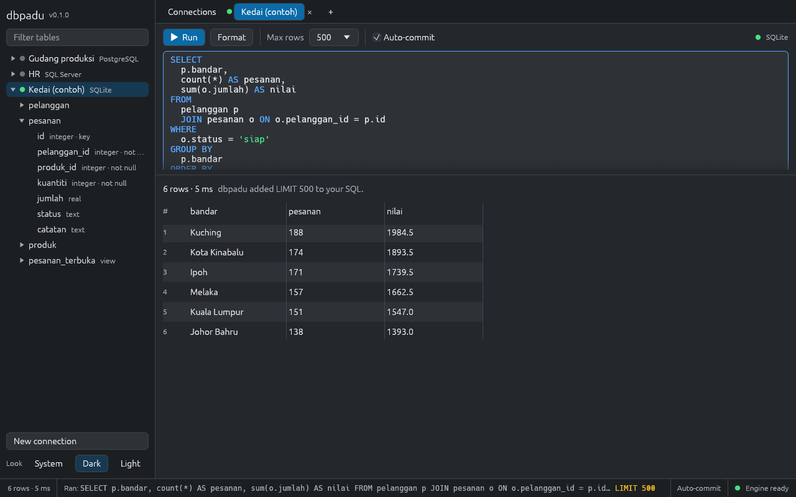
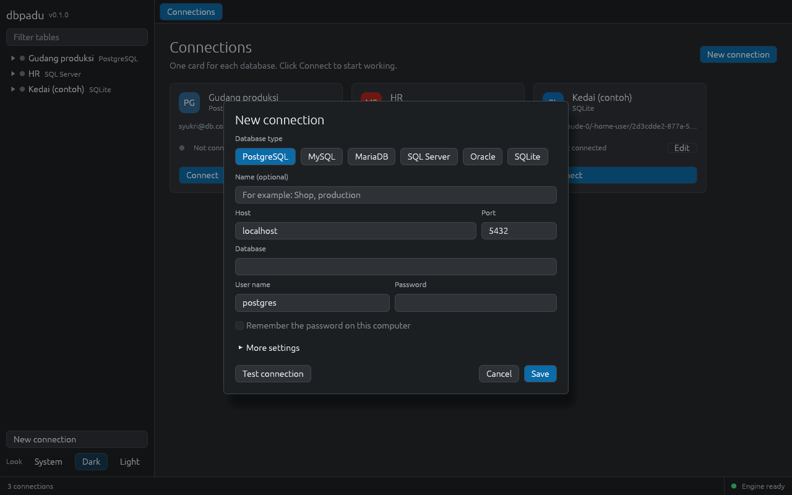

# dbpadu

A friendly desktop database client. The app is written in Rust; the query engine is written in Java and talks to databases through JDBC. Runs on Windows, macOS and Linux.

Version: 0.1.0

| Connections | A query |
| --- | --- |
|  |  |
|  |  |

## Features

| Feature | Status |
| --- | --- |
| One card for each connection, with search; Connect, New query, Edit and Disconnect on the card | Done |
| Connection form in one step: pick the database type, fill in host, port, database, user and password; the port, user and driver settings are filled in for the type; **Test connection** before saving | Done |
| PostgreSQL, MySQL, MariaDB, SQL Server, Oracle and SQLite; every driver is inside the engine, nothing to download | Done |
| Tabs: the pinned Connections tab, then any number of query tabs for each connection | Done |
| Tree on the left: connections, schemas, tables, views and columns (type, key, not null), with a filter; double-click a table to see its rows | Done |
| **A SELECT is always limited** (see [Row limit](#row-limit)) | Done |
| SQL editor with colors; Run the statement at the cursor or the selected text (Ctrl+Enter or F5); Stop a running query | Done |
| Format SQL (Ctrl+Shift+F) | Done |
| Result grid with resizable columns, row numbers, NULL shown apart, copy a value | Done |
| Status bar: result and time, the SQL as it was really sent with what dbpadu added marked, the transaction, and the engine at the far right | Done |
| Transactions: Auto-commit on or off for each connection, Commit and Rollback | Done |
| Passwords in the operating system's credential store (opt-in), never in a file | Done |
| Dark, light or system look | Done |
| Edit cells in the grid, export results, query history, SSH tunnel, app icon | Planned |

## Row limit

A table can hold more rows than a computer has memory for, so dbpadu never asks a database for all of them. Two guards make sure, both in the engine:

1. **The SQL gets a limit.** When a SELECT has no row limit of its own, the engine adds one in the database's own words: `LIMIT 500` (PostgreSQL, MySQL, MariaDB, SQLite), `TOP (500)` (SQL Server) or `FETCH FIRST 500 ROWS ONLY` (Oracle). The status bar shows the SQL as it was sent, with the added part in another color, and the line above the result says so too.
2. **The driver stops at the limit.** Every statement runs with JDBC's `setMaxRows`. This covers the SQL the first guard leaves alone (a query that starts with a bracket, `SELECT … FOR UPDATE`, a `UNION` on SQL Server) and a limit you typed that is larger than the tab's.

The limit is chosen per tab with **Max rows** (100 to 10,000; 500 to start with). The engine refuses more than 10,000 rows whatever it is asked, cuts a single value at 10,000 characters and runs with at most 512 MB of memory. When a result stops at the limit, the line above it says the table may have more.

## How the two parts talk

The app starts the engine as a child process (`java -jar dbpadu-engine.jar`) and the two talk over the engine's standard input and output, one JSON object per line. No network port is opened. The engine stops when the app closes; changes that were not committed are rolled back.

```
app    → {"id": 7, "op": "execute", "session": "…", "sql": "select * from t", "limit": 500}
engine → {"id": 7, "ok": true, "result": {"executedSql": "select * from t\nLIMIT 500", "added": "LIMIT 500", …}}
```

The engine status at the bottom right says whether it is ready. If it stopped, click the status to start it again; rest the pointer on it for the reason.

## Build and run

Requires:

- [Rust](https://rustup.rs) 1.92 or newer
- a JDK, version 17 or newer (for example [Temurin](https://adoptium.net)), to build the engine. To only run dbpadu, any Java 17 or newer is enough.

Maven does not need to be installed: `engine/mvnw` downloads it.

```
./run.sh                                              # macOS and Linux
powershell -ExecutionPolicy Bypass -File .\run.ps1    # Windows, GNU toolchain
```

Both build the engine when it is missing or its code changed, then make a debug build of the app, which compiles faster; add `--release` (`-Release` for `run.ps1`) for an optimized build.

### Release packages

The build scripts build the engine (its tests run too) and a release of the app, and package both in `dist/`.

**Windows**, with the GNU toolchain, so no Visual Studio or Microsoft build tools are needed:

1. Install rustup from [rustup.rs](https://rustup.rs). If it is not installed yet, run the installer as `rustup-init.exe --default-host x86_64-pc-windows-gnu -y`.
2. Install a 64-bit MinGW-w64 gcc (MSVCRT build), for example `winget install -e --id BrechtSanders.WinLibs.POSIX.MSVCRT`, or MSYS2 with `pacman -S mingw-w64-x86_64-gcc`.
3. Install a JDK, for example `winget install -e --id EclipseAdoptium.Temurin.21.JDK`. Open a new terminal afterwards.
4. Run:

   ```powershell
   powershell -ExecutionPolicy Bypass -File .\build.ps1
   ```

The script writes `dist\dbpadu-<version>-windows-x86_64.zip` and copies `dbpadu.exe` and `dbpadu-engine.jar` to the repository folder.

**macOS and Linux:**

```
./build.sh             # .app in a .zip on macOS, .tar.gz on Linux
./build.sh --windows   # Windows .zip, cross-built with MinGW-w64
```

A release is two files that stay together: the program and `dbpadu-engine.jar`. On macOS the engine is inside `dbpadu.app`. The macOS app is not signed; on first launch, right-click it and choose Open.

### Where the app looks for the engine and Java

- The engine: the file named in the `DBPADU_ENGINE_JAR` environment variable, else `dbpadu-engine.jar` next to the program, else `engine/target/dbpadu-engine.jar` when run from the source folder.
- Java: `JAVA_HOME`, else `java` on `PATH`.

## Tests

```
cargo test                    # the app and its crates
cd engine && ./mvnw test      # the engine
```

`cargo test` also starts the real engine against a SQLite file when the engine is built, and checks that the app and the engine have the same version.

## Code layout

| Part | What it does |
| --- | --- |
| `dbpadu` (`src/`) | The desktop app: cards, tabs, tree, query tabs, status bar, themes. Built with [egui/eframe](https://github.com/emilk/egui) |
| `dbpadu-core` (`crates/core`) | Saved connections and settings, saved passwords, SQL formatting, finding the statement at the cursor |
| `dbpadu-engine` (`crates/engine`) | Starts the Java engine and talks to it |
| The engine (`engine/`) | Java: connections, running SQL, the row limit, transactions, reading schemas and tables |

Third-party Rust libraries are declared once, under `[workspace.dependencies]` in the root `Cargo.toml`; the engine's are in `engine/pom.xml`. The version is in both files and must be the same.

## Data

Connections and settings are stored as JSON in the per-user config folder (`%APPDATA%\dbpadu\config\data.json` on Windows, `~/Library/Application Support/dbpadu/data.json` on macOS, `~/.config/dbpadu/data.json` on Linux). Passwords are never written to this file.

A password is asked for when connecting and kept in memory until the app closes. If you tick "Remember", it is saved in the operating system's credential store (Windows Credential Manager or the macOS Keychain).

A new SQL Server connection starts with `encrypt=true;trustServerCertificate=true` under **More settings**, because the driver insists on encryption and most development servers have a certificate it cannot check. For a server with a proper certificate, remove `trustServerCertificate=true`.
