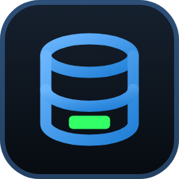
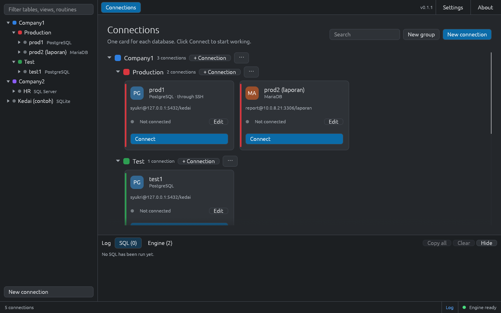
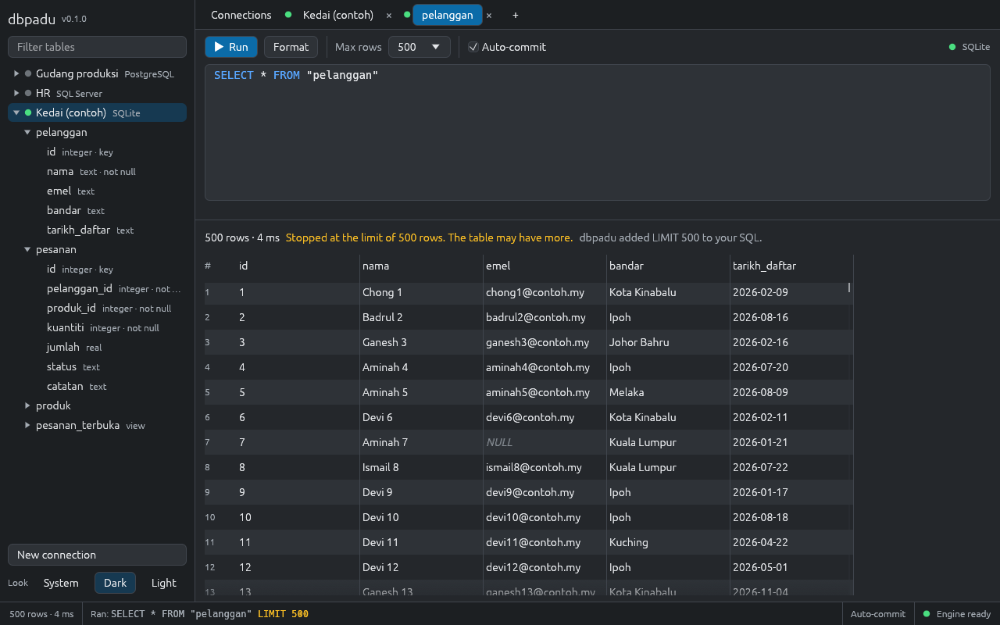
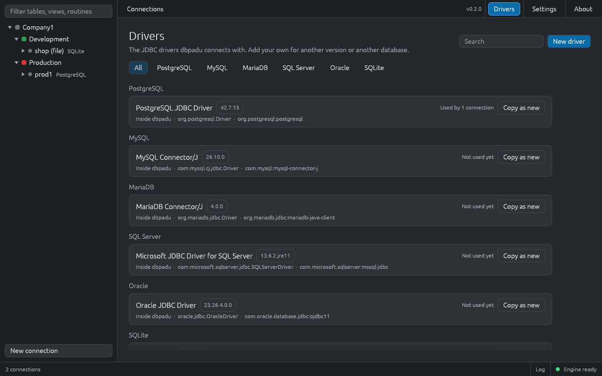
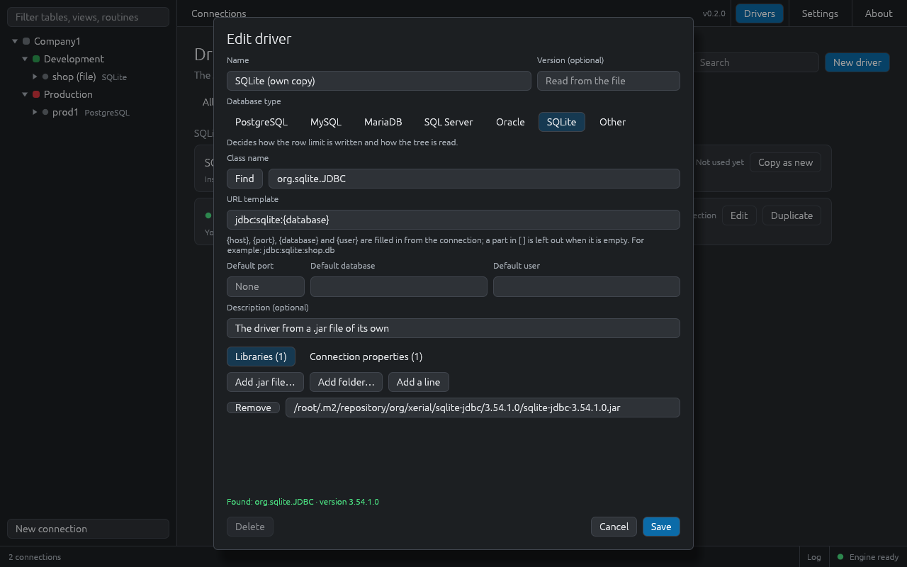
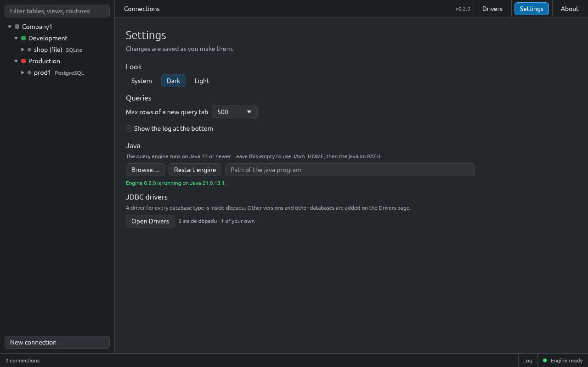

# dbpadu

A friendly desktop database client. The app is written in Rust; the query engine is written in Java and talks to databases through JDBC. Runs on Windows, macOS and Linux.

Version: 0.2.1

| Connections | A query |
| --- | --- |
|  |  |
|  |  |
|  |  |
|  | |

## Features

| Feature | Status |
| --- | --- |
| One card for each connection, with search; Connect, New query, Edit and Disconnect on the card | Done |
| Groups and groups inside groups (for example Company1 › Production › prod1), each with a color that shows on its cards, in the tree and under its query tabs | Done |
| Connection form in one step: pick the driver from the list at the left (name and version), fill in host, port, database, user and password; the port, user and driver settings are filled in for the driver; **Test connection** before saving | Done |
| The form names the JDBC driver that will be used: name, package or class, and version | Done |
| SSH tunnel for a database that is only reachable from another computer: sign in with a password or a private key file (see [SSH](#ssh)) | Done |
| Jump servers (ProxyJump) in front of the SSH server, any number of them | Done |
| PostgreSQL, MySQL, MariaDB, SQL Server, Oracle and SQLite; every driver is inside the engine, nothing to download | Done |
| Drivers page: add, edit, duplicate and delete JDBC drivers of your own, with name, version, class, URL template, default port, `.jar` files and connection properties (see [JDBC drivers](#jdbc-drivers)) | Done |
| Several versions of a driver side by side, for example MySQL 5 and MySQL 8; each connection names the one it uses | Done |
| Any other database that has a JDBC driver, as database type **Other** | Done |
| Tabs: the pinned Connections tab, then any number of query tabs for each connection; version, Drivers, Settings and About at the right | Done |
| Tree on the left: groups, connections, schemas, then Tables, Views, Routines and Sequences, with columns (type, key, not null) under a table and a filter; double-click a table or view to see its rows | Done |
| **A SELECT is always limited** (see [Row limit](#row-limit)) | Done |
| SQL editor with colors; Run the statement at the cursor or the selected text (Ctrl+Enter or F5); Stop a running query | Done |
| Format SQL (Ctrl+Shift+F) | Done |
| Result grid with resizable columns, row numbers, NULL shown apart, copy a value | Done |
| Log at the bottom, read-only: the SQL as it was sent with its result, and what the engine said; Copy all, Clear, Hide | Done |
| Status bar: result and time, the SQL as it was really sent with what dbpadu added marked, the transaction, the log switch, and the engine at the far right | Done |
| Transactions: Auto-commit on or off for each connection, Commit and Rollback | Done |
| Passwords in the operating system's credential store (opt-in), never in a file | Done |
| Settings: dark, light or system look, max rows of a new tab, the Java to run the engine with | Done |
| About: versions, the drivers in use, where the files are | Done |
| App icon: the window, the Windows program and the macOS app | Done |
| Edit cells in the grid, export results, query history | Planned |

## Row limit

A table can hold more rows than a computer has memory for, so dbpadu never asks a database for all of them. Two guards make sure, both in the engine:

1. **The SQL gets a limit.** When a SELECT has no row limit of its own, the engine adds one in the database's own words: `LIMIT 500` (PostgreSQL, MySQL, MariaDB, SQLite), `TOP (500)` (SQL Server) or `FETCH FIRST 500 ROWS ONLY` (Oracle). The status bar shows the SQL as it was sent, with the added part in another color, and the line above the result says so too.
2. **The driver stops at the limit.** Every statement runs with JDBC's `setMaxRows`. This covers the SQL the first guard leaves alone (a query that starts with a bracket, `SELECT … FOR UPDATE`, a `UNION` on SQL Server) and a limit you typed that is larger than the tab's.

The limit is chosen per tab with **Max rows** (100 to 10,000; 500 to start with). The engine refuses more than 10,000 rows whatever it is asked, cuts a single value at 10,000 characters and runs with at most 512 MB of memory. When a result stops at the limit, the line above it says the table may have more.

## SSH

On the **SSH** page of the connection form, switch on **Connect through an SSH server** and fill in the server, the user name and a password or a private key file. The engine signs in to that server and reaches the database from there; **Host** and **Port** on the Main page are then the database as the SSH server sees it. The tunnel listens on this computer only, on a free port, and closes with the connection.

### Jump servers

When this computer cannot reach the SSH server itself, add one or more **jump servers** under it on the same page (what OpenSSH calls ProxyJump, and termker a jump host). dbpadu signs in to the first jump server, reaches the next one from there, and so on up to the SSH server, which reaches the database. Each jump server has its own host, port, user name and password or private key file. What is sent through a jump server is encrypted end to end, so it cannot read it. A jump server must allow forwarding (`AllowTcpForwarding` in its SSH server settings), and the address of the next server must be one that works from the jump server.

An error such as `Connection refused` for the SSH server usually means it is only reachable through a jump server.

The first time a server is used, its key is remembered in `known_hosts` next to `data.json` (About shows the path). If the key ever changes, dbpadu refuses to connect; when the change is expected, remove that server's line from the file.

## JDBC drivers

The engine carries one driver for each database type. The **Drivers** page (at the right of the tab strip) lists them by name and version, with the drivers you added under them.

A JDBC driver does not have to be the newest one: an old server often needs an old driver, and MySQL 5 is not MySQL 8. So drivers of your own are kept side by side, each with a name and a version, and every connection says which one it uses. The engine loads each driver from its own `.jar` files, apart from the others, so two versions of the same driver never get in each other's way.

**New driver** opens the driver form:

| Field | What it is |
| --- | --- |
| Name, Version | What the driver is chosen by, for example `MySQL 5`. The version is read from the `.jar` file when left empty |
| Database type | Decides how the row limit is written and how the tree is read. **Other** is for any database not in the list: the row limit is then kept by the driver alone (`setMaxRows`), and no `LIMIT` is added to the SQL |
| Class name | The driver class, for example `com.mysql.jdbc.Driver`. **Find** looks for it in the libraries; when the files hold one driver it is filled in by itself |
| URL template | The address, with `{host}`, `{port}`, `{database}` and `{user}` where the connection's details go. A part in `[ ]` is left out when it is empty: `jdbc:mysql://{host}[:{port}]/[{database}]` |
| Default port, database, user | What a new connection with this driver starts with |
| Libraries | The driver's `.jar` files, or a folder of them |
| Connection properties | Names and values handed to the driver with every connection, for example `useSSL` = `false` |

**Copy as new** on a driver inside dbpadu starts a driver of your own from it; **Duplicate** copies one of yours, to change into another version. A driver that a connection uses cannot be deleted. In the connection form, the list at the left shows every driver by name and version, and **New driver…** adds one without leaving the form.

## How the two parts talk

The app starts the engine as a child process (`java -jar dbpadu-engine.jar`) and the two talk over the engine's standard input and output, one JSON object per line. No network port is opened. The engine stops when the app closes; changes that were not committed are rolled back.

```
app    → {"id": 7, "op": "execute", "session": "…", "sql": "select * from t", "limit": 500}
engine → {"id": 7, "ok": true, "result": {"executedSql": "select * from t\nLIMIT 500", "added": "LIMIT 500", …}}
```

The engine status at the bottom right says whether it is ready. If it stopped, click the status to start it again; rest the pointer on it for the reason. What the engine writes to its error output is shown in the **Engine** log.

## Build and run

Requires:

- [Rust](https://rustup.rs) 1.92 or newer
- a JDK, version 17 or newer (for example [Temurin](https://adoptium.net)), to build the engine. To only run dbpadu, any Java 17 or newer is enough.

Maven does not need to be installed: `engine/mvnw` downloads it.

```
./run.sh                                              # macOS and Linux
powershell -ExecutionPolicy Bypass -File .\run.ps1    # Windows, GNU toolchain
```

Both build the engine when it is missing or its code changed, then make a debug build of the app, which compiles faster; add `--release` (`-Release` for `run.ps1`) for an optimized build.

### Release packages

The build scripts build the engine (its tests run too) and a release of the app. Everything that is built ends up in `dist/`, ready to run, and the same files are packed in an archive next to them:

| File | What it is |
| --- | --- |
| `dbpadu.exe` (`dbpadu` on Linux) | The program. It only opens the window |
| `dbpadu_ui.dll`, `dbpadu_engine.dll`, `dbpadu_core.dll` (`libdbpadu_….so` on Linux, `.dylib` on macOS) | The app's own libraries, one for each crate in `crates/` |
| `std-….dll` (`libstd-….so`), and on Windows `libgcc_s_seh-1.dll` and `libwinpthread-1.dll` | Rust's standard library, which the three libraries share |
| `dbpadu-engine.jar` | The Java query engine, one file |

The files stay together in one folder. The libraries and the program are built by the same Rust compiler and only fit each other: replace them all together.

**Windows**, with the GNU toolchain, so no Visual Studio or Microsoft build tools are needed:

1. Install rustup from [rustup.rs](https://rustup.rs). If it is not installed yet, run the installer as `rustup-init.exe --default-host x86_64-pc-windows-gnu -y`.
2. Install a 64-bit MinGW-w64 gcc (MSVCRT build), for example `winget install -e --id BrechtSanders.WinLibs.POSIX.MSVCRT`, or MSYS2 with `pacman -S mingw-w64-x86_64-gcc`.
3. Install a JDK, for example `winget install -e --id EclipseAdoptium.Temurin.21.JDK`. Open a new terminal afterwards.
4. Run:

   ```powershell
   powershell -ExecutionPolicy Bypass -File .\build.ps1
   ```

The script fills `dist\` and writes `dist\dbpadu-<version>-windows-x86_64.zip`. Run `dist\dbpadu.exe`.

**macOS and Linux:**

```
./build.sh             # .app in a .zip on macOS, .tar.gz on Linux
./build.sh --windows   # Windows .zip, cross-built with MinGW-w64
```

On macOS everything is inside `dist/dbpadu.app`. The macOS app is not signed; on first launch, right-click it and choose Open.

### Where the app looks for the engine and Java

- The engine: the file named in the `DBPADU_ENGINE_JAR` environment variable, else `dbpadu-engine.jar` next to the program, else `engine/target/dbpadu-engine.jar` when run from the source folder.
- Java: `JAVA_HOME`, else `java` on `PATH`.

## Tests

```
cargo test                    # the app and its crates
cd engine && ./mvnw test      # the engine
```

`cargo test` also starts the real engine against a SQLite file when the engine is built, connects through a driver loaded from a `.jar` file of its own, and checks that the app and the engine have the same version.

## Code layout

| Part | What it does |
| --- | --- |
| `dbpadu` (`src/`) | The program: a few lines that open the window |
| `dbpadu-ui` (`crates/ui`) | The window: cards and groups, tabs, tree, query tabs, log, status bar, Drivers, Settings, About, themes. Built with [egui/eframe](https://github.com/emilk/egui) |
| `dbpadu-engine` (`crates/engine`) | Starts the Java engine and talks to it |
| `dbpadu-core` (`crates/core`) | Saved connections, groups, drivers and settings, saved passwords, URL templates, SQL formatting, finding the statement at the cursor |
| The engine (`engine/`) | Java: connections, SSH tunnels, drivers, running SQL, the row limit, transactions, reading schemas, tables, routines and sequences |

Each crate in `crates/` is built as a shared library (`crate-type = ["dylib"]`), not linked into one program; only the Java engine is one file. They form a chain, `dbpadu` → `dbpadu-ui` → `dbpadu-engine` → `dbpadu-core`, so each third-party library is inside exactly one of them. `.cargo/config.toml` makes Rust's standard library a shared library too and tells the program to look for its libraries in its own folder.

Third-party Rust libraries are declared once, under `[workspace.dependencies]` in the root `Cargo.toml`; the engine's are in `engine/pom.xml`. The version is in both files and must be the same.

## Data

Connections and settings are stored as JSON in the per-user config folder (`%APPDATA%\dbpadu\config\data.json` on Windows, `~/Library/Application Support/dbpadu/data.json` on macOS, `~/.config/dbpadu/data.json` on Linux). Passwords are never written to this file.

A password is asked for when connecting and kept in memory until the app closes. If you tick "Remember", it is saved in the operating system's credential store (Windows Credential Manager or the macOS Keychain). The same goes for an SSH password or the passphrase of an SSH key.

A new SQL Server connection starts with `encrypt=true;trustServerCertificate=true` under **More settings**, because the driver insists on encryption and most development servers have a certificate it cannot check. For a server with a proper certificate, remove `trustServerCertificate=true`.
